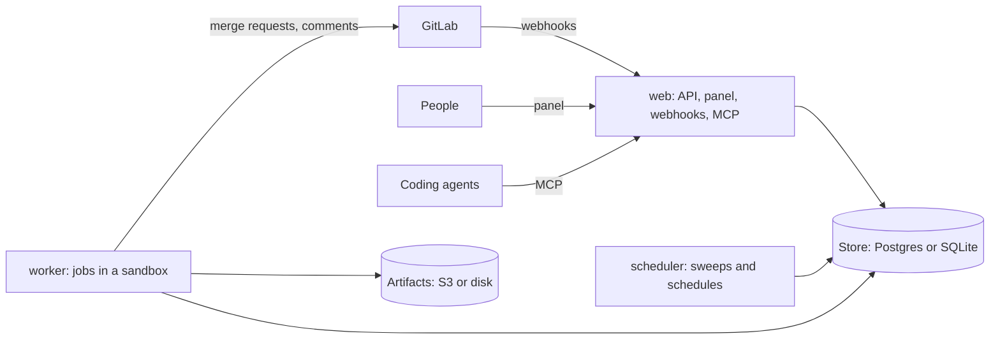
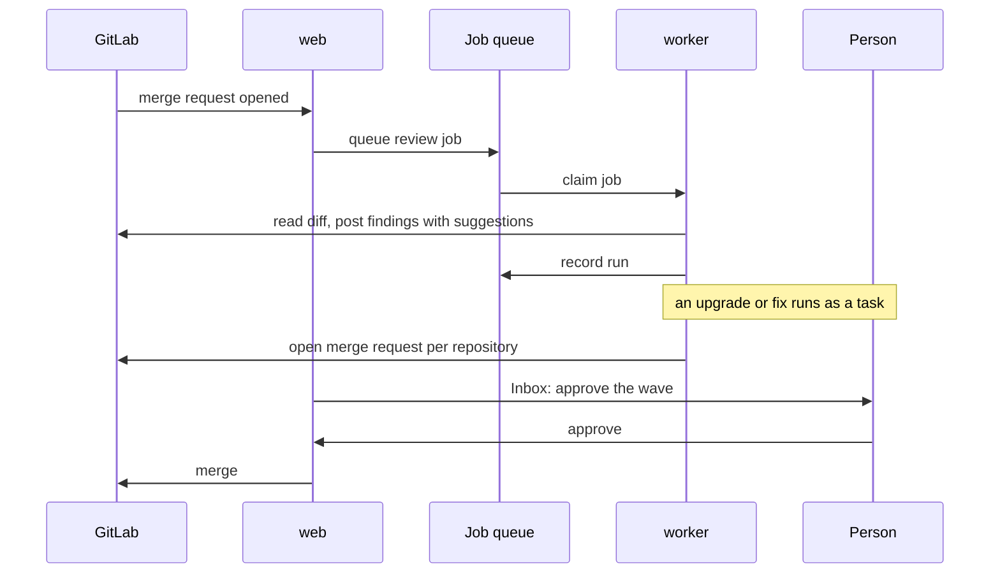

The processes Holtkeeper runs, the contracts its modules depend on, and the path from a webhook to a merged change.

## Processes

One image runs in every setting; a process gets its work from its role (`holtkeeper serve --role web|worker|scheduler|all`).

| Role        | Does                                                |
| ----------- | --------------------------------------------------- |
| `web`       | API, panel, webhooks, MCP endpoint, probes, metrics |
| `worker`    | Runs jobs: checkouts, analyzers, agent tasks        |
| `scheduler` | Schedules and sweeps, under a leader lease          |
| `all`       | Everything in one process (single container)        |

More than one process needs Postgres and S3-compatible artifacts. See the [deployment reference](/self-host/reference/deployment/).

## Contracts

Modules depend on interfaces from contract packages, never on each other's implementations.

| Contract        | Package                                    | Implementations                                                                    |
| --------------- | ------------------------------------------ | ---------------------------------------------------------------------------------- |
| `GitForge`      | [@holtkeeper/forge](/modules/forge/)       | [forge-gitlab](/modules/forge-gitlab/)                                             |
| `Store`         | [@holtkeeper/store](/modules/store/)       | [store-postgres](/modules/store-postgres/), [store-sqlite](/modules/store-sqlite/) |
| `CommandRunner` | [@holtkeeper/exec](/modules/exec/)         | local process, [exec-container](/modules/exec-container/)                          |
| `Analyzer`      | [@holtkeeper/analyzer](/modules/analyzer/) | [analyzers](/modules/analyzers/) and the analysis packages                         |
| Auth            | [@holtkeeper/auth](/modules/auth/)         | auth-users (passkeys), auth-password, auth-header, auth-none                       |
| Vulnerabilities | [@holtkeeper/vuln](/modules/vuln/)         | vuln-osv, vuln-js, vuln-go                                                         |

`GitForge` covers what analyzers need — repositories, branches, merge requests, line comments with suggestions, pipelines, tags and normalized webhook events — and hides the differences between providers inside adapters.

## From a webhook to a merge request

## Configuration split

`holtkeeper.config.ts` holds infrastructure only: store, artifacts, sign-in, vault key, worker execution and limits. Forges, groups, schedules, policies, analyzer options and budgets live in the database and are edited in the panel. See [Configuration](/self-host/configure/configuration/).
