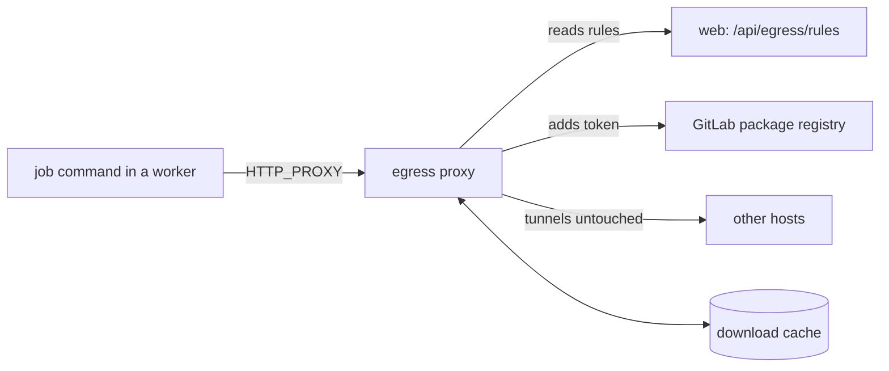

import { Field, Fields, Screen, Strip, Toolbar } from '@ui'

Jobs install dependencies, and some of those live in private registries. The egress proxy is a forward proxy for the network traffic of job commands: it adds credentials to registry requests it recognizes, so jobs install private packages without ever holding a token, and it can keep a cache of package and tool downloads. Holtkeeper's own traffic — the GitLab API, the database, the object store — does not go through it.



## Turn it on in Kubernetes

```yaml title="values.yaml"
existingSecret: holtkeeper # must contain HOLTKEEPER_EGRESS_SECRET=<random string>
egressProxy:
  enabled: true
  ca:
    certManager: true # or existingSecret: a kubernetes.io/tls Secret with the CA
```

The chart deploys `ghcr.io/holtkeeper/holtkeeper-egress-proxy` and gives the workers:

- `HOLTKEEPER_EGRESS_PROXY`, the proxy's URL;
- `HOLTKEEPER_EGRESS_CA`, the CA certificate only, never its key;
- `HOLTKEEPER_EGRESS_NO_PROXY`, the hosts jobs reach directly.

The chart's config turns these into `jobs.execution.egress`. Job commands then get `HTTP_PROXY`/`HTTPS_PROXY` and CA bundles for Node, Bun, curl, git, Go, Python and mise.

To use a proxy of your own — anything that speaks HTTP `CONNECT`, such as Squid with `ssl_bump` — leave `egressProxy` disabled and set `HOLTKEEPER_EGRESS_PROXY` and `HOLTKEEPER_EGRESS_CA` on the workers yourself.

## Package registry tokens

With `egressProxy.forgeRules` (on by default) the proxy reads its rules from the web pods, authenticated with `HOLTKEEPER_EGRESS_SECRET`. Every GitLab forge in the panel then has its token added to downloads from its package registries — always the current token after a rotation. Two switches on the forge control this:

<Screen title="Settings › Integrations › Forges">
  <Toolbar title="gitlab.example.com" />
  <Fields columns={1}>
    <Field
      label="Packages for jobs"
      toggle={true}
      hint="Jobs download private packages from this forge's registries with this token, through the egress proxy. They never see the token, and it is used only to read packages."
    />
    <Field
      label="Cache packages"
      toggle={false}
      hint="The egress proxy keeps the package files jobs download from this forge, so repeated installs skip the forge."
    />
  </Fields>
</Screen>

For other registries, add static rules. `${NAME}` is resolved by the proxy from `egressProxy.existingSecret`, not by Helm:

```yaml title="values.yaml"
egressProxy:
  existingSecret: holtkeeper-egress # REGISTRY_TOKEN=...
  rules:
    - host: registry.example.com
      paths: ['^/npm/']
      headers:
        Authorization: 'Bearer ${REGISTRY_TOKEN}'
```

Only `GET` and `HEAD` get credentials unless a rule lists `methods`, and only over TLS unless it sets `insecure`. TLS to hosts no rule names is tunneled untouched, so those clients see the real certificate. The proxy restarts when static rules change; restart it yourself after changing a static token or the CA.

### Secrets jobs never see

A **Proxy secret** credential in the panel adds a replacement rule: jobs get a placeholder (the panel generates a UUID) and the proxy swaps it for the real secret, only on the hosts the credential names. Put the placeholder in the **Toolchain** setting's `env`, for example `TURBO_TOKEN`; it is useless against any other host. Prefer replacing in headers: a server that stores what it receives in a URL or body could hand the real value back to a job.

## Download cache

`egressProxy.cache` (on by default) keeps immutable archives jobs fetch through the proxy — npm and yarn tarballs, Go modules, PyPI files, crates, Node.js and Go releases, GitHub release assets — so they come from the cache instead of the internet. Indexes and version lists always go upstream, and a broken cache never breaks an install.

```yaml title="values.yaml"
egressProxy:
  cache:
    ttl: { packages: 28d, tools: 21d } # since the last use
    maxSize: 18Gi # least recently used first above this; keep it below the volume
    backend: dir # an emptyDir (dir.sizeLimit, default 20Gi) or dir.type: pvc
```

A `dir` cache on an `emptyDir` is lost when the proxy pod is replaced, and each replica has its own. For more than one replica use `backend: s3` (one bucket for every replica, keys from `s3.existingSecret`) or a ReadWriteMany PVC.

<Screen
  title="Settings › System › Egress proxy cache"
  caption="Package and tool downloads jobs make through the egress proxy. Removing entries needs global settings:write."
>
  <Toolbar title="Egress proxy cache" />
  <Strip
    items={[
      { value: '6.8 GB', label: 'stored · 3,214 entries' },
      { value: '41.0 GB', label: 'saved downloads' },
      { value: '87%', label: 'hit rate', tone: 'ok' },
      { value: '12.4 GB', label: 'served from cache' },
    ]}
  />
</Screen>

For the panel to show the cache, the web pods need `HOLTKEEPER_EGRESS_SECRET` in the top-level `existingSecret`; the chart sets `HOLTKEEPER_EGRESS_CACHE` for them.

:::caution
A cached download is served to every job until it expires, whoever fetched it and whatever changed since. A version unpublished or yanked upstream, or a GitHub asset replaced under the same tag, is still served. With **Cache packages** on, packages fetched with a forge token stay available after the token is revoked or the project's access changes, and every job can read what another job's credentials fetched. Remove entries in **Settings › System** when something has to go at once, and give only the proxy write access to the cache volume or bucket.
:::

## NetworkPolicies

With `networkPolicy.enabled`, workers reach only DNS, the `workerEgress` ports and CIDRs (443, 80 and 22 to anywhere by default), the proxy and `extraEgress`. The proxy accepts only workers (and the web pods when the cache page is used) and reaches the web pods for its rules. Write workers reach only DNS, the proxy, `extraEgress` and `writeWorker.extraEgress`: everything else goes through the proxy.

If you narrow `workerEgress.cidrs`, keep these destinations reachable:

| Destination                           | Called from                          | Why                                                       |
| ------------------------------------- | ------------------------------------ | --------------------------------------------------------- |
| GitLab (`gitlab.example.com`)         | web, workers, proxy                  | API, git over HTTPS (port 22 for SSH), package registries |
| Package registries and tool downloads | proxy, workers                       | Dependency installs, mise                                 |
| Your AI provider's API                | workers, proxy (write workers)       | Reviews and agent tasks                                   |
| `slack.com`                           | web and workers                      | Slack messages and review status emoji                    |
| Postgres and the object store         | every Holtkeeper pod (`extraEgress`) | Store and artifacts                                       |

Web pods have no egress policy of their own; only their ingress is restricted, to `webIngressFrom`.

## Related

- [Kubernetes](/self-host/run/kubernetes/) — write workers and NetworkPolicies.
- [Job execution](/self-host/configure/job-execution/) — which variables commands keep.
- [Deployment reference](/self-host/reference/deployment/#egress-proxy) — every proxy option.
- [Egress proxy image](https://github.com/holtkeeper/holtkeeper/blob/main/docker/egress-proxy/README.md) — rules, cache and admin API.
