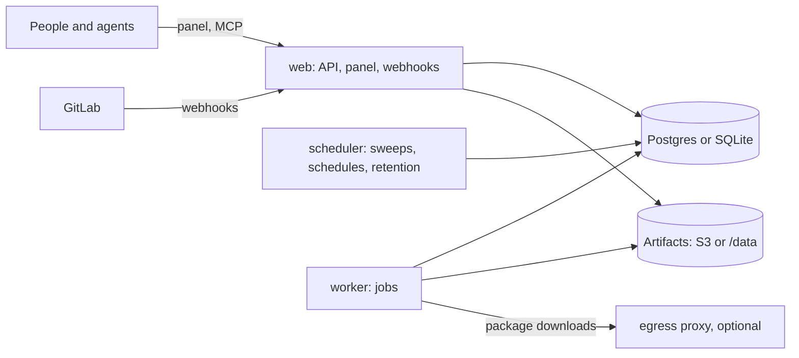

import { Card, Cards } from '@ui'

Holtkeeper ships as one container image. Every process runs the same `holtkeeper serve` command and gets its work from its role, so the same image serves a laptop trial, a Compose host and a Kubernetes cluster. This section is for the person who runs it: picking a layout, writing the config file, signing in the first admin, and keeping the instance healthy.

## Processes and roles

| Role        | Serves                                | Runs jobs | Scheduler duties |
| ----------- | ------------------------------------- | --------- | ---------------- |
| `web`       | API, panel, webhooks, probes, metrics | no        | no               |
| `worker`    | probes and metrics only               | yes       | no               |
| `scheduler` | probes and metrics only               | no        | yes              |
| `all`       | everything                            | yes       | yes              |

Roles combine with commas: `--role web,scheduler` is what Compose and the Helm chart run in their web containers. Several processes may hold the scheduler role; they contend for a lease in the store and only the holder runs the duties. The [deployment reference](/self-host/reference/deployment/) has the details.

## Choose a layout

| Layout                                               | Store    | Artifacts | Good for                                                            |
| ---------------------------------------------------- | -------- | --------- | ------------------------------------------------------------------- |
| [Single container](/self-host/run/single-container/) | SQLite   | `/data`   | Trying it out, a small fleet, one host                              |
| [Compose with workers](/self-host/run/compose/)      | Postgres | S3        | One host, several workers you scale by hand                         |
| [Kubernetes](/self-host/run/kubernetes/)             | Postgres | S3        | Autoscaled workers, one job per pod, NetworkPolicies, write workers |

Start with a single container if you are unsure. Moving to Postgres and S3 later is a config change, but the data does not move by itself: plan the switch before the instance holds history you care about.

## The config file and the panel

Holtkeeper splits its configuration in two.

**`holtkeeper.config.ts`** holds infrastructure only, and is read at start:

- `server`: sign-in provider, store, `vaultKey`, listener, `publicUrl`, artifacts and their retention, the egress rules secret, credential rotation;
- `jobs`: execution mode and its egress proxy, `concurrency`, `cacheDir`, `timeoutMinutes`, the shared `webhookSecret`;
- `limits.distributed`, `ai.providers` and `dryRun`.

**The panel** holds everything else, stored in the database: forges with their token credentials, groups, repository traits, schedules, triggers, merge request policies, analyzer options, the AI budget and every other setting. After the first sign-in you add your GitLab forge (for example `https://gitlab.example.com`) and its groups in [Settings › Integrations](/guide/settings/integrations/).

:::note
A config file that still has `forges`, `groups`, `repos`, `plugins`, `jobs.schedules`, `jobs.on*`, `jobs.commands`, `jobs.botUsername` or `jobs.webhooks` starts anyway. Each such key logs one warning and is ignored; add the forge and groups again in the panel.
:::

The starting configs in the repository (`deploy/holtkeeper.config.ts` for Docker and Compose, the chart's `files/holtkeeper.config.ts` for Kubernetes) read every secret from the environment and switch to Postgres and S3 when their variables are set, so most installs only set variables. See [Configuration](/self-host/configure/configuration/) for a walk-through and [Environment variables](/reference/environment/) for every variable.

## More than one process

As soon as web and workers run as separate processes, they need shared state:

1. **Postgres.** SQLite is a local file: it works for one process, or several in one container sharing the file, but not for pods on different nodes.
2. **S3-compatible artifacts.** Workers write artifacts and web processes serve them. Any S3-compatible storage works: AWS S3, Cloudflare R2, Garage, Ceph, MinIO, Versity S3 Gateway.
3. **Distributed limits.** `limits: { distributed: true }` keeps credential rate limits in the store, so all workers share one token's budget. The bundled config turns it on with Postgres.
4. **The same vault key everywhere.** Every process must have the same `HOLTKEEPER_VAULT_KEY`.

:::caution
The vault key seals every stored credential and secret setting. Never rotate or regenerate it on a running instance, and keep a copy outside the instance: without it, a database backup is unreadable. See [Backups](/self-host/operate/backups/).
:::

## Related

<Cards>
  <Card title="Single container" href="/self-host/run/single-container/">
    One process with SQLite and a data volume.
  </Card>
  <Card title="Compose" href="/self-host/run/compose/">
    Web, workers, Postgres and S3 on one host.
  </Card>
  <Card title="Kubernetes" href="/self-host/run/kubernetes/">
    The Helm chart with roles, scaling and isolation.
  </Card>
  <Card title="Deployment reference" href="/self-host/reference/deployment/">
    Every flag, metric and chart option in depth.
  </Card>
</Cards>
