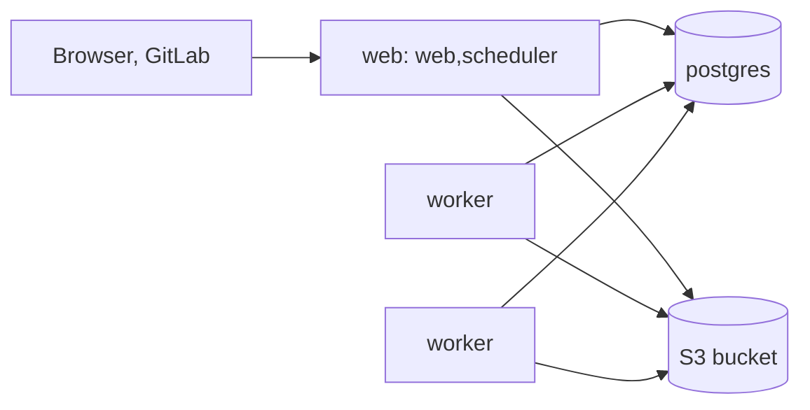

`deploy/docker-compose.yml` runs Holtkeeper as separate processes on one host: a `web` service that serves the panel and runs the scheduler, a `worker` service you scale, Postgres 17, and artifacts in any S3-compatible storage. Without storage of your own, a profile starts a local S3 gateway next to it.



## What is in the file

| Service          | Runs                                 | Notes                                                                           |
| ---------------- | ------------------------------------ | ------------------------------------------------------------------------------- |
| `web`            | `--role web,scheduler`               | Publishes port `7420` (`HOLTKEEPER_HTTP_PORT` changes it).                      |
| `worker`         | `--role worker --drain-timeout 50s`  | Scale with `--scale worker=N`; `/workspace` is a tmpfs, `/mise` a named volume. |
| `postgres`       | `postgres:17-alpine`                 | Data in the `postgres` volume; web and workers wait for its health check.       |
| `versitygw`      | Versity S3 Gateway on a local folder | Only with `--profile local-s3`.                                                 |
| `versitygw-init` | Creates the bucket directory         | Only with `--profile local-s3`.                                                 |

Every Holtkeeper service uses the same image (`HOLTKEEPER_IMAGE`, default `holtkeeper:latest`), mounts `deploy/holtkeeper.config.ts` read-only, runs with a read-only root filesystem, no capabilities and `no-new-privileges`, and gets 60 seconds to stop.

## Set it up

1. Build the images (see [Single container](/self-host/run/single-container/#what-you-need)) or set `HOLTKEEPER_IMAGE` to a published one, such as `ghcr.io/holtkeeper/holtkeeper:<version>`.
2. Copy the env template and fill it in:

   ```sh title="Terminal"
   cd deploy && cp .env.example .env && $EDITOR .env
   ```

3. Start it with as many workers as you want:

   ```sh title="Terminal"
   docker compose up -d --scale worker=3
   ```

4. Open port `7420`, sign in as `root` with `HOLTKEEPER_ROOT_PASSWORD`, and add your GitLab forge in [Settings › Integrations](/guide/settings/integrations/).

```sh title="deploy/.env"
POSTGRES_PASSWORD=change-me
S3_ENDPOINT=https://s3.example.com
S3_BUCKET=holtkeeper
S3_REGION=us-east-1
# S3_QUOTA=107374182400
S3_ACCESS_KEY_ID=holtkeeper
S3_SECRET_ACCESS_KEY=change-me
HOLTKEEPER_ROOT_PASSWORD=change-me
HOLTKEEPER_SESSION_SECRET=
HOLTKEEPER_VAULT_KEY=
HOLTKEEPER_WEBHOOK_SECRET=
HOLTKEEPER_PUBLIC_URL=https://holtkeeper.example.com
```

The Compose file turns `POSTGRES_PASSWORD` and the `S3_*` values into `HOLTKEEPER_DATABASE_URL` and `HOLTKEEPER_S3_*` for every Holtkeeper service. The three secrets need at least 32 characters each (`openssl rand -hex 32`). Never commit the filled-in file.

:::caution
`HOLTKEEPER_VAULT_KEY` must be the same in every service, and must never change once credentials are stored. Keep a copy outside the host.
:::

## Artifacts in S3

Point `S3_ENDPOINT`, `S3_BUCKET`, `S3_REGION` and the keys at storage you already run: AWS S3, Cloudflare R2, Garage, Ceph, MinIO or Versity S3 Gateway. `S3_QUOTA` (bytes) is optional: Holtkeeper cannot read a provider's quota, so this figure is only shown against usage in **Settings › System**.

### Try it with the local S3 profile

Leave `S3_ENDPOINT` unset and start the bundled gateway too:

```sh title="Terminal"
docker compose --profile local-s3 up -d
```

`versitygw` serves the `s3-data` volume through the posix backend at `http://versitygw:7070`, with `S3_ACCESS_KEY_ID` and `S3_SECRET_ACCESS_KEY` as its credentials, and `versitygw-init` creates the bucket directory. Without the profile both are skipped, and so is the dependency on them.

## A fresh container per job

Add `'--max-jobs', '1'` to the worker command: each worker exits after one job and `restart: unless-stopped` starts a clean one. Nothing from one job's checkout is left for the next.

## How jobs run here

Jobs run inside the worker containers in `mise` mode: each worker is the sandbox, and tools are installed into the shared `mise-cache` volume. Do not switch to `container` mode under Compose: it needs the host's Docker socket in the worker, which defeats the isolation. See [Job execution](/self-host/configure/job-execution/).

## Single container from the same file

The file has a commented `holtkeeper` service with `--role all` and SQLite in a `data` volume. Comment out `web`, `worker` and `postgres`, uncomment `holtkeeper` and the `data` volume, and you have the [single-container](/self-host/run/single-container/) layout under Compose.

## Related

- [Scaling](/self-host/operate/scaling/) — how many workers and how much concurrency.
- [Backups](/self-host/operate/backups/) — `pg_dump`, bucket versioning, the vault key.
- [Configuration](/self-host/configure/configuration/) — what the mounted config holds.
- [Deployment reference](/self-host/reference/deployment/#compose)
