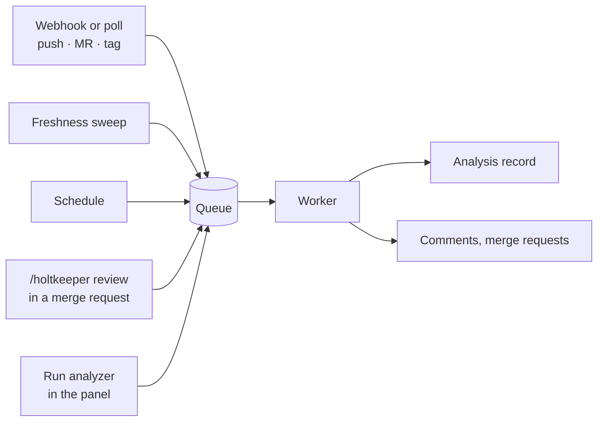

import { Button, Screen, Scroll, Strip, Tag, Toolbar } from '@ui'

Everything Holtkeeper does to a repository is an **analyzer**: reviewing a merge request, scanning advisories, measuring bundles, reading the stack, indexing the public API. An analyzer never runs on its own. Something queues a **run** of it (a webhook, the freshness sweep, a schedule, a command in a merge request, a button in the panel) and a worker picks the run up, checks out the repository if needed, and stores the result as an analysis record.

## Analyzers

Each analyzer has a kind (`review`, `audit`, `licenses`, `bundle`, `coverage`, `stack`, `api-surface`, ...), options and a scope: most work on one repository, a few on a whole group. Options are ordinary scoped settings named `analyzers.<kind>`, so a team can set its own bundle budgets or review strictness while the rest of the fleet keeps the defaults. You find them on the page that owns the analyzer (its <Button ghost>Configure</Button> button) and all together in **Settings › Analyzers**.

Some analyzers only read: they produce data and reports. Others write: the review posts comments, propagation and upgrades open merge requests. Writing analyzers respect [freezes and review switches](/start/concepts/policies/).

An analyzer only runs where it applies. The browserslist refresh, for example, runs only in repositories whose lockfile resolves `caniuse-lite`, so an analyzer added to every group still skips repositories with nothing to do.

## What queues a run

| Source         | When                                                                                     | Set up in                                    |
| -------------- | ---------------------------------------------------------------------------------------- | -------------------------------------------- |
| Freshness      | An analysis went stale: a new commit on the default branch, its refresh interval passed. | Built in; tuned per team in Ops › Automation |
| New repository | A group lists a repository for the first time: every read-only analyzer runs once.       | Default trigger                              |
| Event trigger  | A tag, push, merge request (opened, updated, reopened), label or `/holtkeeper` command.  | Ops › Automation                             |
| Schedule       | A cron or interval over some groups.                                                     | Ops › Automation                             |
| Policy         | A merge request policy asks for an analyzer as one of its actions.                       | Ops › Automation                             |
| By hand        | <Button>Run analyzer</Button> on a repository, Runs or Settings › Analyzers.             | Needs `analyses:run`                         |

Freshness is what keeps the fleet current without schedules: every analyzer says how fresh its data must be, and a sweep every few minutes queues what fell behind, within hourly caps and a night window. A fresh install has two event triggers: every read-only analyzer on new repositories, and the public API snapshot on every tag. Merge request review needs a trigger you add; see [Turn on AI review](/start/first-steps/ai-review/).

## Runs

A run is one analyzer on one repository (or group) at one ref. The queue runs at most one job per analyzer and repository at a time, and a run asked for twice while it waits is queued once. Runs that call an AI model draw on the weekly AI budget; when automatic work would pass it, they are **blocked** instead of spending.

**Ops › Runs** lists every run you may read, with why it ran, how long it took, how often it was tried and what it cost.

<Screen title="Ops › Runs" caption="The line under each analyzer says why a run waits, failed or was stopped.">
  <Toolbar title="Runs">
    <Button primary>Run analyzer</Button>
  </Toolbar>
  <Strip
    items={[
      { value: '2 / 2', label: 'workers busy' },
      { value: 5, label: 'queued' },
      { value: 2, label: 'running · $0.31' },
      { value: 1, label: 'failed', tone: 'bad' },
      { value: 1, label: 'blocked by budget', tone: 'warn' },
    ]}
  />
  <Scroll>

| Status                         | Analyzer                         | Repository · ref                | Trigger        | Duration | Cost  |
| ------------------------------ | -------------------------------- | ------------------------------- | -------------- | -------- | ----- |
| <Tag tone="info">Running</Tag> | review · `!42`                   | `acme/checkout-web` · `a1b2c3d` | merge request  | 1 min    | $0.18 |
| <Tag tone="ok">Done</Tag>      | bundle                           | `acme/admin-ui` · `main`        | freshness      | 3 min    | —     |
| <Tag tone="bad">Failed</Tag>   | coverage · test command exited 1 | `acme/widget-kit` · `main`      | new repository | 4 min    | —     |
| <Tag tone="warn">Blocked</Tag> | guide · Stopped by the AI budget | `acme/docs-site` · `main`       | freshness      | —        | —     |

  </Scroll>
</Screen>

A run opens with its steps, log and, for AI runs, every model call. A failure that repeats across repositories is grouped under **Recurring failures**, so one broken base image does not look like twenty problems.

## Analysis records

A finished run stores a record: the analyzer's own data plus a report in one shared format, so every analysis opens in the same viewer and any two runs compare (by default against the previous release). Fleet pages such as Quality › Bundles or Supply chain › Libraries read only these stored records; opening a page never starts a run.

## Related

- [Runs](/guide/ops/runs/) and [Automation](/guide/ops/automation/) — the screens in detail.
- [Settings › Analyzers](/guide/settings/analyzers/) — options, health and overrides per analyzer.
- [Tasks and the Inbox](/start/concepts/tasks-and-inbox/) — work that changes code.
