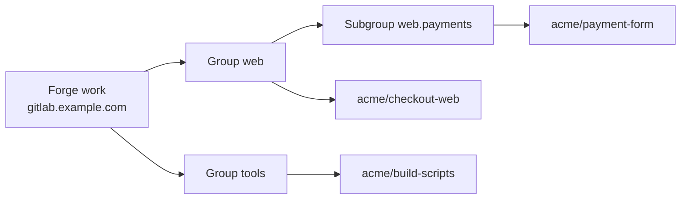
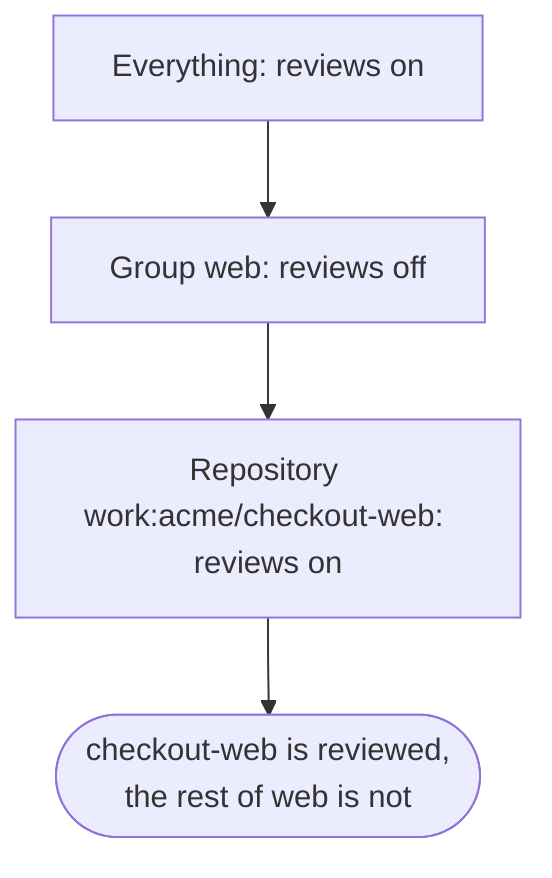

import { Screen, Scroll, Tag, Toolbar, Strip } from '@ui'

Holtkeeper looks after a fleet: every repository it knows, on every forge you connected, sorted into groups that usually match your teams. The same few ideas come back on every screen. A **forge** is where repositories live, a **group** is a named set of repositories, and a **scope** says which repositories a grant, setting, budget or note covers. When several entries cover one repository, the most specific one wins.

## Forges

A forge is one GitLab instance with the token Holtkeeper uses on it. You add forges in **Settings › Integrations**; the config file has none. Each forge has a short id, and every repository is addressed as `<forge>:<path>`, for example `work:acme/checkout-web`. That is why the id never changes after you create the forge.

The token decides what Holtkeeper can see and do: it lists projects, reads files, comments on merge requests and opens branches as the account behind the token. GitLab is the only forge today; GitHub is coming.

## Repositories

A repository is a project on a forge that some group includes. Holtkeeper lists group members from the forge every 30 minutes, so a new project that matches a group's pattern joins on its own, and gets every read-only analyzer once on its default branch.

Holtkeeper learns about changes in two ways, and behaves the same with either:

- **Polling**, on by default: every five minutes, slower while webhooks deliver.
- **Webhooks**, per forge or per repository, for changes within seconds.

## Groups and subgroups

A group is a set of include and exclude patterns on one forge: exact paths (`acme/checkout-web`) or globs (`acme/web-*`, `acme/**`). Groups usually stand for teams, and the panel calls them teams in places such as **My teams**.

A repository may sit in several groups at once, so groups also work as tags: `web` and `payments` can overlap. Scopes can ask for an **intersection**, written `web + payments`, meaning repositories that are in both.

A **subgroup** sits one level under a root group, keyed `<parent>.<name>`, such as `web.payments`. It only ever holds members of its parent, so everything scoped to the parent keeps covering it, and its own entries win over the parent's. Groups can carry a display name that the panel shows instead of the key; grants, settings and links always use the key.

<Screen title="Repos › Groups" caption="Subgroups fold under their parent and only pick from its members.">
  <Toolbar title="Groups" />
  <Scroll>

| Group                           | Patterns                          | Members | Health                                 |
| ------------------------------- | --------------------------------- | ------- | -------------------------------------- |
| **Web** · `web`                 | `acme/web-*`, `acme/checkout-web` | 14      | <Tag tone="warn">3 with warnings</Tag> |
| ↳ **Payments** · `web.payments` | `acme/payment-*`                  | 4       | <Tag tone="ok">All healthy</Tag>       |
| **Tools** · `tools`             | `acme/build-*`                    | 6       | <Tag tone="bad">1 failing</Tag>        |

  </Scroll>
</Screen>

## Scopes

Grants, settings, AI budget caps, merge request policies, credentials and knowledge are all stored with a scope. A scope is one of:

| Scope                    | Example                          | Covers                                          |
| ------------------------ | -------------------------------- | ----------------------------------------------- |
| Everything               | all repositories                 | the whole instance, global objects included     |
| Group                    | `web`                            | every repository of the group and its subgroups |
| Subgroup or intersection | `web.payments`, `web + payments` | repositories in all the named groups            |
| Path glob                | `work:acme/web-*`                | repositories whose path matches                 |
| Repository               | `work:acme/checkout-web`         | one repository                                  |

## The most specific entry wins

When several entries of one setting cover a repository, Holtkeeper picks the narrowest, in this order:

1. an exact repository path,
2. a path glob,
3. a subgroup or a group intersection (more groups first),
4. a group,
5. everything.

Ties go to the entry changed most recently. The winning entry applies as a whole; values are never merged field by field.

So an organization-wide default, a team's override and one repository's exception live side by side, and each repository shows which one applies. The repository hub's **Settings** tab lists every setting with its winning value and where it comes from.

<Screen title="Repos › acme/checkout-web › Settings">
  <Toolbar title="Settings" crumbs={['acme/checkout-web']} />
  <Strip items={[{ value: 41, label: 'settings' }, { value: 2, label: 'overridden here' }, { value: 9, label: 'not default' }]} />
  <Scroll>

| Setting               | Value      | Source                          |
| --------------------- | ---------- | ------------------------------- |
| Merge request reviews | On         | <Tag tone="acc">This repo</Tag> |
| Largest upgrade       | `minor`    | <Tag>Org</Tag>                  |
| Read-only             | Not frozen | <Tag>Default</Tag>              |

  </Scroll>
</Screen>

:::note
Grants follow the same scopes but are additive: a person may do an action on a repository when any of their grants covers it. See [Roles and permissions](/start/concepts/permissions/).
:::

## Related

- [Add repositories](/start/first-steps/add-repositories/) — create groups and subgroups in the panel.
- [Settings and policies](/start/concepts/policies/) — what scoped settings control.
- [Repositories](/guide/repos/repositories/) and [Groups](/guide/repos/groups/) — the screens in detail.
