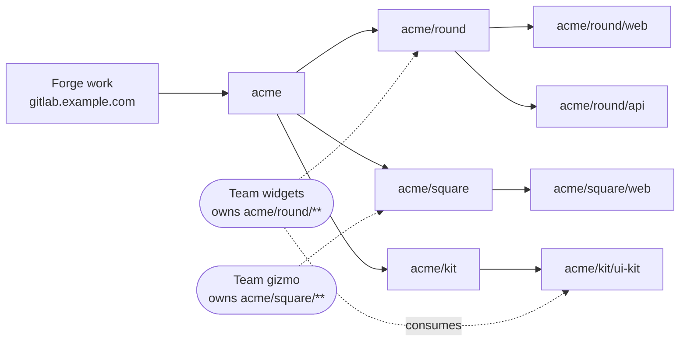
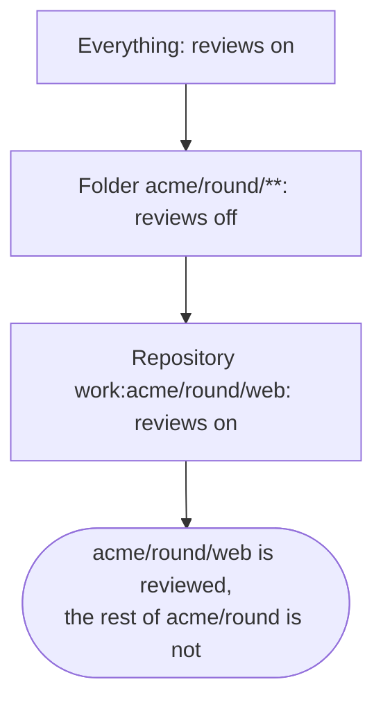

import { Screen, Scroll, Tag, Toolbar, Strip } from '@ui'

Holtkeeper looks after a fleet: every repository it works on, on every forge you connected. The same few ideas come back on every screen. A **forge** is where repositories live, and its **folders** (`acme/round`) are how they are arranged. A **team** owns some repositories and consumes others. A **scope** says which repositories a grant, setting, budget or note covers: everything, some teams, or some path patterns. When several entries cover one repository, the most specific one wins.

## Forges

A forge is one GitLab instance with the token Holtkeeper uses on it. You add forges in **Settings › Integrations**; the config file has none. Each forge has a short id, and every repository is addressed as `<forge>:<path>`, for example `work:acme/round/web`. That is why the id never changes after you create the forge.

The token decides what Holtkeeper can see and do: it lists projects, reads files, comments on merge requests and opens branches as the account behind the token. GitLab is the only forge today; GitHub is coming.

## Paths and folders

Holtkeeper does not keep a second tree of its own: the forge already arranges repositories in folders, and every prefix of a repository's path is a folder. `acme/round/web` sits in the folder `acme/round`, which sits in `acme`. The **Repos** page shows them as a folder tree beside the table; with one forge its root is left out.

A **path pattern** picks repositories by path:

| Pattern          | Matches                                                                    |
| ---------------- | -------------------------------------------------------------------------- |
| `acme/round/web` | exactly that repository                                                    |
| `acme/round/*`   | every repository directly in `acme/round` (`*` is one folder or name)      |
| `acme/round/**`  | every repository anywhere under `acme/round` (`**` is any number)          |
| `acme/*/web`     | `acme/round/web`, `acme/square/web`: alike repositories in sibling folders |
| `work:acme/**`   | everything under `acme`, on the forge `work` only                          |

A pattern without a forge prefix matches on every forge. Patterns that decide what is in the fleet (forge includes, team **owns** and **consumes**) must start with a folder: `acme/**`, not `**/web`.

Moving a project on the forge changes its path, so patterns follow it only when its new path still matches.

## What is in the fleet

Holtkeeper works on two kinds of repositories, on every forge:

- those a **team owns or consumes**, through the team's patterns;
- those the forge's **Fleet** includes: the **Include** and **Exclude** patterns under **Settings › Integrations**, on the forge. Include a folder there to look after repositories nobody owns yet.

Holtkeeper lists every forge's fleet every 30 minutes, so a new project under an included or owned folder joins on its own, and gets every read-only analyzer once on its default branch. Exact paths added with **Add repository** are in the fleet at once.

Holtkeeper learns about changes in two ways, and behaves the same with either:

- **Polling**, on by default: every five minutes, slower while webhooks deliver.
- **Webhooks**, per forge or per repository, for changes within seconds.

## Teams

A team is a key (`widgets`), a title (_Widgets_), the patterns it **owns** minus those it **excludes**, the patterns it **consumes**, and its **members**, each a maintainer or a member. Teams live on [Repos › Teams](/guide/repos/teams/).

- **Owner teams.** A repository's owners are every team whose **owns** matches it. A shared library may have several; a repository only the forge's fleet includes has none.
- **Consumers.** A team that consumes a repository depends on it without answering for it: its members may read it, and it shows as context on the team's pages. A consumer never counts as the same team.
- **Membership is access.** Maintainers may do everything on their team's repositories; members get the day-to-day actions (read, run analyzers and releases, approve tasks, write knowledge); everyone in the team may read what it consumes. No separate grant is needed.
- **Who edits a team.** Maintainers may change the title and members. **Owns**, **Exclude** and **Consumes** widen or narrow access, so only someone with `settings:write` over everything changes them.

The panel shows a team's title everywhere; grants, settings, links and schedules use its key.

<Screen title="Repos › Teams" caption="A shared library can have several owner teams.">
  <Toolbar title="Teams" />
  <Scroll>

| Team                      | Patterns                                      | Repositories    | Health                                 |
| ------------------------- | --------------------------------------------- | --------------- | -------------------------------------- |
| **Widgets** · `widgets`   | owns `acme/round/**` · consumes `acme/kit/**` | 9 · +2 consumed | <Tag tone="warn">2 with warnings</Tag> |
| **Gizmo** · `gizmo`       | owns `acme/square/**`, `acme/kit/ui-kit`      | 8               | <Tag tone="ok">All healthy</Tag>       |
| **Platform** · `platform` | owns `acme/kit/**`                            | 4               | <Tag tone="bad">1 failing</Tag>        |

  </Scroll>
</Screen>

Teams and folders answer different questions. Folders say where a repository lives, so settings and code rules follow them. Teams say who answers for it, so access, the Inbox and process rules follow them. Repositories that are alike but live apart, such as `acme/round/web` and `acme/square/web`, meet through a pattern (`acme/*/web`) or a **family** in Knowledge.

## Scopes

Grants, settings, AI budget caps, merge request policies, credentials and knowledge are all stored with a scope. A scope is one or more of:

| Scope        | Example               | Covers                                             |
| ------------ | --------------------- | -------------------------------------------------- |
| Everything   | all repositories      | the whole instance, global objects included        |
| Team         | `widgets`             | every repository the team owns                     |
| Path pattern | `acme/round/**`       | repositories whose path matches; a folder, a shape |
| Repository   | `work:acme/round/web` | one repository                                     |

Entries of one scope add up: `widgets` plus `acme/kit/**` covers both.

## The most specific entry wins

When several entries of one setting cover a repository, Holtkeeper picks the narrowest, in this order:

1. an exact repository path,
2. a path pattern, the deeper folder first (`acme/round/**` before `acme/**`),
3. a team,
4. everything.

A scope ranks by its broadest part, ties go to the entry changed most recently, and the winning entry applies as a whole; values are never merged field by field.

So an organization-wide default, a folder's override and one repository's exception live side by side, and each repository shows which one applies. Settings are best set on folders: a repository with two owner teams would get two team values, and the panel offers paths first for that reason. The repository hub's **Settings** tab lists every setting with its winning value and where it comes from.

<Screen title="Repos › acme/round/web › Settings">
  <Toolbar title="Settings" crumbs={['acme/round/web']} />
  <Strip items={[{ value: 41, label: 'settings' }, { value: 2, label: 'overridden here' }, { value: 9, label: 'not default' }]} />
  <Scroll>

| Setting               | Value      | Source                          |
| --------------------- | ---------- | ------------------------------- |
| Merge request reviews | On         | <Tag tone="acc">This repo</Tag> |
| Coverage target       | 75%        | <Tag>Path pattern</Tag>         |
| Largest upgrade       | `minor`    | <Tag>Org</Tag>                  |
| Read-only             | Not frozen | <Tag>Default</Tag>              |

  </Scroll>
</Screen>

:::note
Grants follow the same scopes but are additive: a person may do an action on a repository when any of their grants, or their team membership, covers it. See [Roles and permissions](/start/concepts/permissions/).
:::

## Related

- [Add repositories](/start/first-steps/add-repositories/) — bring repositories into the fleet and give them an owner team.
- [Settings and policies](/start/concepts/policies/) — what scoped settings control.
- [Repositories](/guide/repos/repositories/) and [Teams](/guide/repos/teams/) — the screens in detail.
