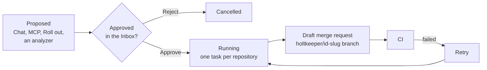

import { Button, Kbd, Screen, Scroll, Segmented, Strip, Tag, Toolbar, Ui } from '@ui'

Analyzers read; **tasks** change code. A task group is one request (a dependency upgrade, a fix for an advisory, a change asked for in Chat or by a coding agent) applied to one or more repositories. For each repository an agent edits a checkout, runs the repository's checks, pushes a branch and opens a draft merge request. Nothing runs until a person approves it, and the place to approve is the **Inbox**.

## Task groups

A group has a kind, a title, a prompt or plan (sometimes a ready patch) and its target repositories, ten at most by default. Every repository gets its own task on a shared branch name, `holtkeeper/<group id>-<slug>`, and its own draft merge request. People still review and merge those merge requests on the forge; Holtkeeper never pushes to a default branch.

Tasks come from several places:

- **Chat**: ask for a change and turn the answer into a task.
- **Coding agents** over MCP, with `start_task`.
- **Supply chain › Libraries**: <Ui>Roll out</Ui> an upgrade of a library across the repositories that use it.
- **Analyzers** that find something they can fix, such as an internal package bump whose checks fail.

## Waves

Rolling a new version of a library out to every repository that uses it is a **wave**. Holtkeeper plans it without cloning: it reads each repository's manifests, bumps the version, runs the checks and opens one merge request per repository. Where the checks fail, it proposes a fix task that hands the agent the package's changelog and migration notes. The wave's report shows which repositories updated cleanly, which needed a fix and which failed, compared with the previous wave of the same package.

## Writes are off until you turn them on

Write tasks stay refused until an admin turns on **Agents may change code** in **Ops › Tasks**. Turning it on asks for confirmation and names the risks: repository scripts run on write workers, merge requests go out under the forge token, one wrong change can reach many repositories, and tasks spend from the weekly AI budget. They also need write workers in the `mise` or `container` sandbox; see [Self-host](/self-host/).

Each group has a spend cap (by default $1.50 per repository and $5 per group, $40 a week in all), shown as `≤ $5.00` while it waits for approval.

:::caution
Approving a task needs the `tasks:run` permission on every repository it writes to. Repositories under a freeze are refused when the task is queued and again when it starts.
:::

## The Inbox

The Inbox (Home › Inbox) gathers every decision you may make, oldest first:

| Kind           | Decision                                                                  |
| -------------- | ------------------------------------------------------------------------- |
| Task proposals | **Approve** or **Reject**; nothing runs before approval.                  |
| Notes          | **Accept** or **Reject** a knowledge note an agent or person proposed.    |
| Learnings      | **Accept** a rule learned from review replies into a scope, or reject it. |
| Guide          | **Accept** or **Reject** generated Guide text.                            |
| Releases       | **Accept** a release candidate that waits for a person.                   |
| Allowlist      | **Renew** an allowlisted advisory that is about to expire.                |
| Budget         | **Acknowledge** that this week's AI spend passed the warning line.        |

Items in your home groups land in **Waiting for you**; what your other grants let you decide shows under **Your teams can also decide**. Snooze an item for a day or a week and it comes back on its own. The rail's Home item carries the open count.

<Screen title="Home › Inbox" caption="A row opens the item in a side sheet with its diff, plan and context.">
  <Toolbar title="Inbox">
    <Segmented items={['For me', 'My teams']} active={1} />
  </Toolbar>
  <Strip
    items={[
      { value: 4, label: 'waiting for you' },
      { value: 2, label: 'more for your teams' },
      { value: 1, label: 'expiring within 7 days', tone: 'warn' },
      { value: '3 days', label: 'oldest wait' },
    ]}
  />
  <Scroll>

| Item                                                 | Kind                             | Scope           | Waiting |                                  |
| ---------------------------------------------------- | -------------------------------- | --------------- | ------- | -------------------------------- |
| Upgrade `@acme/widget-kit` to 6.0 · 5 repositories   | <Tag>Task proposal</Tag>         | `web`           | 3 days  | <Button primary>Approve</Button> |
| Prefer `fetchJson` over raw `fetch` in API clients   | <Tag>Learning</Tag>              | `web`           | 1 day   | <Button>Accept</Button>          |
| `GHSA-abcd-1234-wxyz` allowlisted in `acme/admin-ui` | <Tag tone="warn">Allowlist</Tag> | `acme/admin-ui` | 2 hours | <Button>Renew</Button>           |

  </Scroll>
</Screen>

Select several rows to approve, reject or snooze them at once, or step through them with <Kbd>J</Kbd> / <Kbd>K</Kbd> and decide with <Kbd>A</Kbd>, <Kbd>R</Kbd> or <Kbd>S</Kbd>. Decisions are made by people: they are not available to agents over MCP.

After approval, follow the group in **Ops › Tasks**: running, opened merge request with its CI, failed (with **Retry**) or ended.

## Related

- [Inbox](/guide/home/inbox/) and [Tasks](/guide/ops/tasks/) — the screens in detail.
- [Roles and permissions](/start/concepts/permissions/) — who may approve.
- [Connect coding agents](/agents/connect/) — proposing tasks from an editor.
